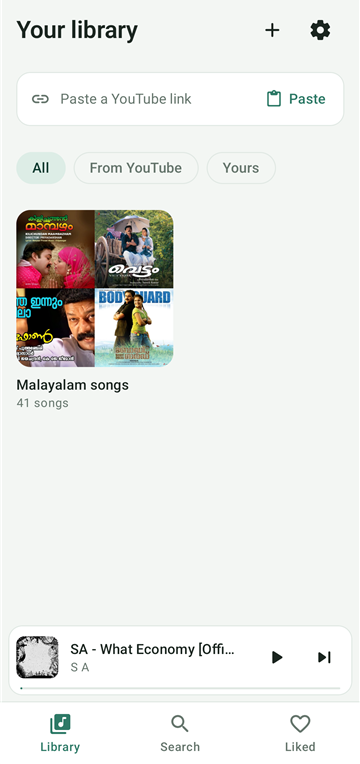

# Potify

An Android music player that saves the audio of YouTube playlists and videos to your phone, so you can listen offline. Built with Jetpack Compose, with a calm "Sage" theme and a dark mode.

<p align="center">
  
</p>

## Features

- **Paste or share any YouTube link.** Playlists are saved as playlists. Single videos (`youtu.be`, `watch?v=`, Shorts, YouTube Music) go into **Added songs**. A song opened from inside a playlist asks whether you want just the song or the whole playlist.
- **Offline library** with cover art, per-song download progress, and Pause/Resume for the download queue.
- **Liked songs** and **your own playlists**: add any saved song with ⋮ → Add to playlist.
- **Now Playing** with large artwork, seek bar, previous/next, shuffle, repeat (off / all / one), a sleep timer (15–60 min or end of song), and lock-screen and notification controls.
- **Queue** that you can rearrange by dragging the ≡ handle. You can also remove songs or jump to any song. This works in both shuffled and normal order.
- **Search** across saved songs and playlists.
- **Refresh** a YouTube playlist to pick up newly added videos.
- **Storage controls:** delete a song's download, delete playlists (audio no other playlist uses is removed), and *Free up space* in Settings.
- **Picks up where you left off:** the last queue and position come back when you reopen the app.
- **Audio quality setting:** *Best* (Opus ~160 kbps, about 1.2 MB per minute) or *Data saver* (~70 kbps, about 0.5 MB per minute).

## Building

Requirements: **JDK 17** and the **Android SDK** (platform 35). Android Studio provides both.

Tell Gradle where the SDK is, either with a `local.properties` file in the project root:

```properties
sdk.dir=C\:\\Android\\Sdk
```

or with the `ANDROID_HOME` environment variable. Then build the debug APK:

```powershell
.\gradlew.bat :app:assembleDebug
```

On macOS/Linux use `./gradlew :app:assembleDebug`. The APK is written to `app/build/outputs/apk/debug/app-debug.apk`.

To install it on a phone with USB debugging enabled:

```powershell
adb install -r app/build/outputs/apk/debug/app-debug.apk
```

`-r` updates an existing install and keeps your downloaded songs. The app supports Android 8.0 (API 26) and newer.

## How it works

| Area | Files | What it does |
|---|---|---|
| Screens | `ui/` (Compose) | Library, Playlist, Search, Settings, Now Playing, mini player, theme |
| App state | `AppViewModel.kt` | Exposes the library as flows; re-queries off the main thread whenever the database changes |
| Database | `Library.java` | SQLite tables for playlists, tracks and playlist items; likes, your playlists, cleanup |
| Link parsing | `YouTubeLink.java` | Finds video and playlist IDs in shared text; only accepts YouTube hosts |
| YouTube | `YouTubeSource.java` | Uses [NewPipeExtractor](https://github.com/TeamNewPipe/NewPipeExtractor) to read playlists and pick the audio-only stream |
| Downloading | `DownloadBatch.java`, `ChunkedDownload.java` | Background queue: 3 songs at a time, each fetched in 2 MB byte-range chunks (2 in parallel) |
| Background work | `Downloads.java`, `PlaylistJob.java`, `LegacyDownloadService.java` | User-initiated job on Android 14+, foreground service on older versions |
| Artwork | `Artwork.kt` | Saves a 480 px square crop of each video thumbnail for offline cover art |
| Playback | `PlaybackService.kt`, `PlayerConnection.kt` | Media3 ExoPlayer in a `MediaSessionService`; the screen talks to it through a `MediaController` |

Files live in the app's private storage: audio in `files/audio`, artwork in `files/thumbs`, and the database in `databases/library.db`.

### Download speed

YouTube throttles downloads to about playback speed unless the request looks like its own player's. Potify requests audio the way YouTube's player does: POST requests with a `range=` parameter, a request number, and the user agent of the YouTube client the stream URL was issued to (see `YouTubeSource.streamHeaders`). Downloads then run at roughly the full speed of the connection. Each finished download logs its format, bitrate, size and speed under the `PotifyDownload` tag:

```powershell
adb logcat -s PotifyDownload
```

### Shuffle

ExoPlayer's own shuffle order is fixed when the queue is loaded, and turning shuffle on doesn't move the current song to the start. Every song placed before it in that order would be skipped. So `PlaybackService` builds its own order whenever shuffle turns on or a shuffled queue starts: **the current song first, then every other song once, in random order**. Reordering the queue while shuffled sends a custom session command that rewrites that order. With repeat-all, the same shuffled order loops.

## Notes

- Potify is a personal project. Respect YouTube's Terms of Service and copyright, and only save content you have the right to keep offline.
- YouTube changes often. If reading playlists or downloads start failing, update `NewPipeExtractor` in `app/build.gradle` first.
- The database schema is versioned in `Library.java` (currently version 2). Any schema change needs a step added to `onUpgrade`.
